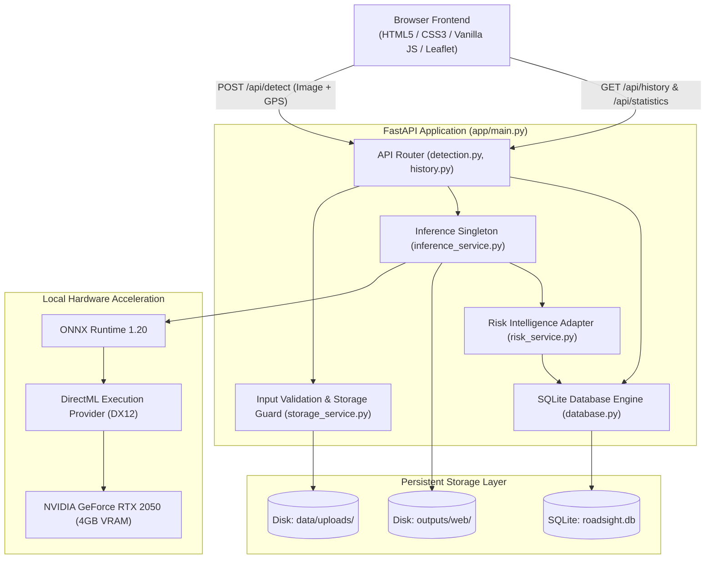

# RoadSight AI — Technical Architecture & Engineering Overview

---

## 1. System Architecture

RoadSight AI is an end-to-end computer vision and explainable risk intelligence system engineered for municipal road damage assessment. It bridges high-throughput neural network inference with deterministic, auditable civic decision-making.



---

## 2. Computer Vision & ONNX Execution Pipeline

### Model Details
- **Architecture:** YOLO11n (Ultralytics YOLO11 Nano adapted for road damage).
- **Source Dataset:** RDD2022 (Road Damage Detection 2022 dataset: 47,000+ real road frames across multiple countries).
- **Format:** Open Neural Network Exchange (`ONNX` format, opset 17).
- **Model Size:** $10.12\text{ MB}$ ($10,607,022$ bytes).
- **Input Tensor:** $1 \times 3 \times 640 \times 640$, float32 normalized $[0.0, 1.0]$ in RGB channel order.
- **Output Tensor:** $1 \times 8 \times 8400$, containing center coordinates $(c_x, c_y, w, h)$ and 4 class probability logits across 8,400 candidate anchor locations.

### Supported Damage Class Taxonomy

| Class Index | Dataset Code | Damage Classification | Civic Impact & Hazard Profile |
| :---: | :---: | :--- | :--- |
| **0** | `D00` | **Longitudinal Crack** | Surface seam cracks parallel to traffic direction; precursor to water ingress. |
| **1** | `D10` | **Transverse Crack** | Thermal shrinkage cracks perpendicular to road centerline; causes road surface bumpiness. |
| **2** | `D20` | **Alligator Crack** | Interconnected fatigue cracking resembling reptile scales; indicates base structural failure. |
| **3** | `D40` | **Pothole** | Structural bowl-shaped cavity in asphalt; immediate cause of wheel/suspension damage and accidents. |

### Preprocessing & Letterboxing
To preserve aspect ratio without distortion:
1. Scale ratio $r = \min\left(\frac{640}{H_{\text{orig}}}, \frac{640}{W_{\text{orig}}}\right)$.
2. Calculate padded dimensions and center offsets: $p_x = \frac{640 - W_{\text{new}}}{2}$, $p_y = \frac{640 - H_{\text{new}}}{2}$.
3. Standard OpenCV letterbox resize with neutral gray padding $(114, 114, 114)$.
4. Color conversion from BGR to RGB, transpose to $(3, 640, 640)$, and float32 normalization by $\frac{1}{255.0}$.

### Postprocessing & Multi-Class NMS
1. Tensor transposition from $(1, 8, 8400)$ to $(8400, 8)$.
2. Extraction of $(c_x, c_y, w, h)$ and multi-class confidence scores: $c = \max(\text{class\_scores})$.
3. Confidence threshold filtering (default $0.25$, adjustable $0.10$–$0.75$).
4. Coordinate unpadding back to original image space $(x_1, y_1, x_2, y_2)$:
   $$x_1 = \max\left(0, \frac{c_x - w/2 - p_x}{r}\right), \quad y_1 = \max\left(0, \frac{c_y - h/2 - p_y}{r}\right)$$
5. Class-aware Non-Maximum Suppression (NMS) with IoU threshold $0.45$ via `cv2.dnn.NMSBoxes`.

### DirectML Hardware Acceleration
- **Execution Provider:** `DmlExecutionProvider` executing on DirectX 12 via DirectML.
- **Physical Hardware:** NVIDIA GeForce RTX 2050 (4 GB GDDR6 VRAM, GA107 Ampere architecture).
- **Session Singleton:** Managed by `InferenceService.get_instance()`. The model is pre-warmed during FastAPI application startup with a dummy tensor, avoiding runtime shader re-compilation.
- **Warm Inference Latency:** **$12.35$ ms to $12.70$ ms** per frame.

---

## 3. Explainable Risk Intelligence Engine

Civil road maintenance cannot rely on black-box predictions. The RoadSight AI risk engine ([risk_engine.py](file:///c:/Users/prath/Downloads/Road/risk_engine.py)) computes a deterministic, bounded score between $0$ and $100$ based on four documented engineering factors:

$$\text{Hazard Score} = \min\left(100, \max\left(0, \text{Round}\left(S_A + S_B + S_C + S_D\right)\right)\right)$$

### Factor Breakdown

| Factor | Component | Max Weight | Operational Formulation |
| :--- | :--- | :---: | :--- |
| **Factor A** | **Damage Severity** | **40 pts** | • **Pothole (`D40`):** `40.0 pts`<br>• **Alligator Crack (`D20`):** `30.0 pts`<br>• **Transverse Crack (`D10`):** `22.0 pts`<br>• **Longitudinal Crack (`D00`):** `18.0 pts` |
| **Factor B** | **Estimated Damaged Area** | **20 pts** | Visual frame coverage ratio $r = \frac{(x_2 - x_1)(y_2 - y_1)}{W_{\text{img}} \times H_{\text{img}}}$.<br>Scaled linearly against a 5% frame saturation threshold: $S_B = \min\left(20.0, 20.0 \times \frac{r}{0.05}\right)$. |
| **Factor C** | **Detector Confidence** | **15 pts** | Scaled model probability: $S_C = 15.0 \times c$. |
| **Factor D** | **Road Importance** | **25 pts** | • **Highway / Major Arterial:** `25.0 pts`<br>• **Main Urban Thoroughfare:** `18.0 pts`<br>• **Residential Street:** `12.0 pts`<br>• **Internal / Low-Traffic Road:** `6.0 pts`<br>• **Unknown / Unclassified (Default):** `15.0 pts` |
| **Total** | **Combined Hazard Index** | **100 pts** | Bounded integer between 0 and 100. |

### Operational Triage Thresholds

| Priority Tier | Score Range | Operational Meaning & Recommended Civic Action |
| :--- | :---: | :--- |
| **CRITICAL** | **80 – 100** | **Emergency Dispatch:** Immediate danger to vehicular safety. Scheduled repair within 24 hours. |
| **HIGH** | **60 – 79** | **Priority Maintenance:** Significant structural deterioration. Scheduled repair within 48–72 hours. |
| **MODERATE** | **40 – 59** | **Routine Monitoring:** Surface degradation present. Added to bi-weekly inspection schedule. |
| **LOW** | **0 – 39** | **Minor / Normal:** Minor hairline cracks or clean road surface. Standard preventive maintenance. |

---

## 4. Database Schema & Persistence

SQLite (`roadsight.db`) is configured with foreign key enforcement (`PRAGMA foreign_keys = ON;`) across two relational tables:

```sql
-- Parent Table: Inspection Run Record
CREATE TABLE IF NOT EXISTS analyses (
    id INTEGER PRIMARY KEY AUTOINCREMENT,
    original_filename TEXT NOT NULL,
    upload_timestamp TEXT NOT NULL,
    image_path TEXT NOT NULL,
    annotated_path TEXT NOT NULL,
    latitude REAL,
    longitude REAL,
    road_category TEXT NOT NULL,
    overall_risk_score INTEGER NOT NULL,
    priority_category TEXT NOT NULL,
    inference_ms REAL NOT NULL,
    total_ms REAL NOT NULL,
    summary_explanation TEXT NOT NULL
);

-- Child Table: Individual Bounding-Box Hazards
CREATE TABLE IF NOT EXISTS detections (
    id INTEGER PRIMARY KEY AUTOINCREMENT,
    analysis_id INTEGER NOT NULL,
    damage_class TEXT NOT NULL,
    confidence REAL NOT NULL,
    bbox_x1 REAL NOT NULL,
    bbox_y1 REAL NOT NULL,
    bbox_x2 REAL NOT NULL,
    bbox_y2 REAL NOT NULL,
    individual_risk_score INTEGER NOT NULL,
    priority_category TEXT NOT NULL,
    explanation TEXT NOT NULL,
    FOREIGN KEY (analysis_id) REFERENCES analyses(id) ON DELETE CASCADE
);

-- B-Tree Performance Indices
CREATE INDEX IF NOT EXISTS idx_detections_analysis ON detections(analysis_id);
CREATE INDEX IF NOT EXISTS idx_detections_class ON detections(damage_class);
CREATE INDEX IF NOT EXISTS idx_analyses_priority ON analyses(priority_category);
CREATE INDEX IF NOT EXISTS idx_analyses_timestamp ON analyses(upload_timestamp);
```

---

## 5. API Endpoints Specification

All endpoints follow strict Pydantic schemas:

| Endpoint | Method | Input Parameters | Return Type | Description |
| :--- | :---: | :--- | :--- | :--- |
| `/api/health` | `GET` | None | `HealthResponseSchema` | Model status, DirectML provider, GPU target. |
| `/api/detect` | `POST` | Multipart: `file`, `confidence_threshold`, `latitude`, `longitude`, `road_category` | `AnalysisResponseSchema` | End-to-end detection, risk scoring, and SQLite persistence. |
| `/api/history` | `GET` | `limit`, `offset`, `priority` | `HistoryResponseSchema` | Paginated inspection audit history with defect counts. |
| `/api/history/{id}` | `GET` | `analysis_id` in path | `AnalysisDetailSchema` | Full inspection record including all child hazard bounding boxes. |
| `/api/statistics` | `GET` | None | `StatisticsResponseSchema` | Live aggregates: counts by class, priority, and road category. |
| `/api/images/{id}` | `GET` | `analysis_id` in path, `type` (`annotated` \| `original`) | Binary `image/jpeg` | Streams annotated or original image file with HTTP caching. |

---

## 6. Geographic Information System (GIS) Architecture

- **Map Library:** Leaflet 1.9.4.
- **Tile Provider:** OpenStreetMap CartoDB Dark Matter.
- **Marker Logic:** Custom SVG pin rendering colored by priority tier (`#ef4444` Critical, `#f97316` High, `#eab308` Moderate, `#22c55e` Low).
- **Geospatial Integrity:** Records lacking GPS coordinates are never plotted at fabricated coordinates $(0, 0)$; they are routed to the separate **Unlocated Inspections** registry.

---

## 7. Technical Limitations

1. **2D Frame Coverage Proxy:** Damaged area is estimated from a 2D bounding-box pixel ratio against image area. True volumetric pothole depth requires 3D stereoscopic or LiDAR sensor inputs.
2. **Single Camera Perspective:** Visual hazard assessments are sensitive to extreme vehicle camera vibration and dark night captures without street illumination.
3. **No Dynamic Traffic Sensor Inputs:** Road importance is selected via functional classification rather than real-time vehicle telematics.
