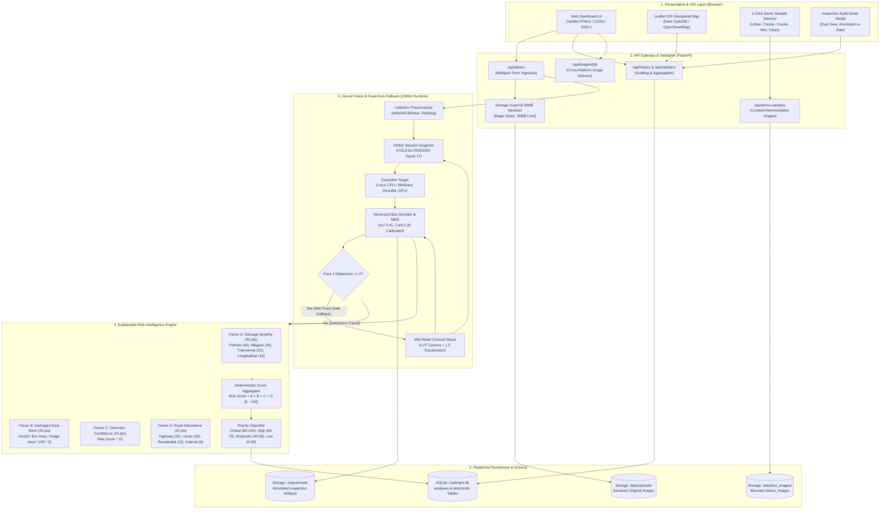
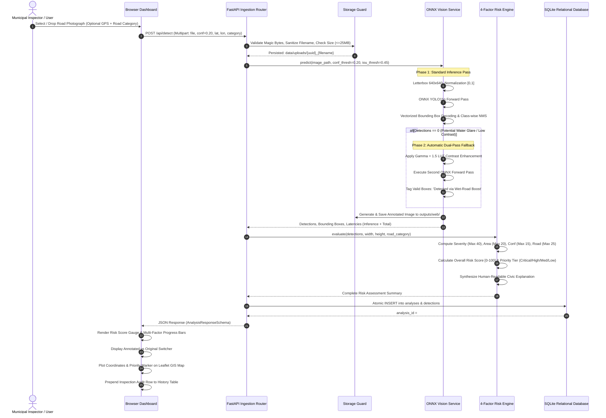

# RoadSight AI — Road Hazard Detection & Municipal Risk Intelligence System

[](https://python.org)
[](https://fastapi.tiangolo.com)
[](https://onnxruntime.ai)
[](https://leafletjs.com)
[](https://opensource.org/licenses/MIT)

> **Autonomous Road Infrastructure Monitoring**: An explainable computer vision and civic risk assessment platform designed for municipal engineers, public works departments, and smart city operations.

---

## 1. System Architecture

RoadSight AI decouples lightweight client ingestion from accelerated neural network inference, deterministic multi-factor risk scoring, and relational audit logging.



---

## 2. End-to-End Data Flow (Input to Output)

The lifecycle of an inspection request transitions through five strictly validated phases:



---

## 3. Major Components and Their Interactions

### 1. Presentation & GIS Layer (`static/`)
- **Interactive Dashboard (`index.html`, `style.css`)**: Built with vanilla ES6+ and modern CSS grid/flex architecture. Avoids heavy frontend frameworks to minimize overhead and eliminate bundle latency.
- **Geospatial GIS Engine (`app.js`, Leaflet 1.9.4)**:
  - Consumes Dark CartoDB / OpenStreetMap tile layers with container dimension invalidation (`invalidateSize`) across responsive breakpoints.
  - Plots geocoded road inspections with color-coded priority pins (Red: Critical, Orange: High, Yellow: Moderate, Green: Low).
  - Isolates inspections lacking GPS into an **Unlocated Inspections** municipal sidebar.
- **1-Click Quick Demo Selector**: Pre-loads curated real-world inspection scenarios (submerged wet potholes, multi-pothole clusters, alligator cracking, urban potholes, and undamaged smooth highways) for instant evaluation.

### 2. API Gateway & Ingestion Layer (`app/main.py`, `app/routes/`)
- **FastAPI Application Factory**: Implements CORS middleware, global exception masks to prevent stack trace leaks, and asynchronous file handlers.
- **Storage Guard (`app/services/storage_service.py`)**:
  - Enforces strict file validation (MIME types: `image/jpeg`, `image/png`, `image/webp`).
  - Validates file headers using magic byte inspection.
  - Generates collision-proof UUID filenames to prevent filesystem traversal and path injection.
- **Cross-Platform Image Delivery (`/api/images/{analysis_id}`)**:
  - Handles path resolution across POSIX (Linux/Render) and Windows file separators.
  - Automatically falls back to high-resolution SVG archive placeholders (HTTP 200) if cloud container restarts wipe ephemeral upload caches, eliminating broken image requests.

### 3. Neural Vision & Dual-Pass Fallback Pipeline (`app/services/inference_service.py`, `infer.py`)
- **Model Architecture**: YOLO11n fine-tuned on the RDD2022 dataset (Road Damage Detection 2022), packaged in ONNX opset 17 ($10.12\text{ MB}$).
- **Taxonomy**:
  - `pothole` (RDD2022 D40): Structural surface cavities.
  - `alligator_crack` (RDD2022 D20): Fatigue/crocodile interconnected structural cracking.
  - `longitudinal_crack` (RDD2022 D00): Linear cracks parallel to traffic flow.
  - `transverse_crack` (RDD2022 D10): Linear cracks perpendicular to traffic flow.
- **Automatic Dual-Pass Fallback (Wet-Road Contrast Boost)**:
  - **Pass 1**: Executes raw inference with calibrated default confidence threshold ($\tau = 0.20$).
  - **Pass 2 (Conditional)**: If and only if Pass 1 returns zero detections, the engine dynamically activates a non-linear gamma lookup table ($\gamma = 1.5$) to penetrate specular water reflection and puddle glare.
  - Detected hazards from Pass 2 are tagged for auditing: *"Detected via Wet-Road / Puddle Contrast Boost"*.

### 4. Explainable Civil Risk Intelligence Engine (`app/services/risk_service.py`, `risk_engine.py`)
Unlike opaque end-to-end classifiers, RoadSight AI uses an **auditable, deterministic 4-factor scoring formulation** calibrated for municipal infrastructure budgets:

$$\text{Risk Score} = \text{Factor}_A + \text{Factor}_B + \text{Factor}_C + \text{Factor}_D$$

| Factor | Description | Points | Formula / Weight |
| :--- | :--- | :---: | :--- |
| **Factor A** | **Damage Class Severity** | 0 – 40 | Pothole ($40$), Alligator Crack ($30$), Transverse Crack ($22$), Longitudinal Crack ($18$) |
| **Factor B** | **Damaged Area Ratio** | 0 – 20 | $\min\left(20, \frac{\text{Bounding Box Area}}{\text{Image Area}} \times 100 \times 2.0\right)$ |
| **Factor C** | **Detection Confidence** | 0 – 15 | $\text{Confidence Score} \times 15.0$ |
| **Factor D** | **Road Category Context** | 0 – 25 | Highway ($25$), Main Urban ($18$), Residential ($12$), Internal/Low-Traffic ($6$), Unknown ($15$) |

#### Municipal Priority Classification
- **Critical Priority ($80 - 100$)**: Immediate structural road hazard. Dispatch emergency repair within 24–48 hours.
- **High Priority ($60 - 79$)**: Severe surface deterioration. Schedule for upcoming municipal maintenance cycle.
- **Moderate Priority ($40 - 59$)**: Surface fatigue. Add to routine quarterly surveillance.
- **Low Priority ($0 - 39$)**: Minor hairline cracks or no detected defects. Acceptable road condition.

### 5. Relational Persistence Layer (`app/database.py`, `roadsight.db`)
- Relational SQLite schema with atomic transactions.
- `analyses` table stores root inspection metadata (timestamps, GPS coordinates, road category, overall risk score, execution latency).
- `detections` table stores individual child defects (bounding box coordinates, class taxonomy, confidence, individual risk points, inference pass tags) linked via `FOREIGN KEY (analysis_id) REFERENCES analyses(id) ON DELETE CASCADE`.
- Indexed on `upload_timestamp`, `priority_category`, and `damage_class` for sub-millisecond retrieval.

---

## 4. Input-to-Output Data Specification

### Input Request Format
`POST /api/detect` (`multipart/form-data`)

```http
POST /api/detect HTTP/1.1
Content-Type: multipart/form-data; boundary=----BoundaryXYZ

------BoundaryXYZ
Content-Disposition: form-data; name="file"; filename="pothole_sample.jpg"
Content-Type: image/jpeg

[RAW BINARY IMAGE DATA]
------BoundaryXYZ
Content-Disposition: form-data; name="confidence_threshold"

0.20
------BoundaryXYZ
Content-Disposition: form-data; name="latitude"

12.971598
------BoundaryXYZ
Content-Disposition: form-data; name="longitude"

77.594562
------BoundaryXYZ
Content-Disposition: form-data; name="road_category"

main_urban
------BoundaryXYZ--
```

### Output Response Format
`HTTP/1.1 201 Created` (`application/json`)

```json
{
  "analysis_id": 142,
  "original_filename": "pothole_sample.jpg",
  "upload_timestamp": "1732160000.0",
  "image_dimensions": "720x960",
  "road_category": "main_urban",
  "latitude": 12.971598,
  "longitude": 77.594562,
  "overall_risk_score": 75,
  "priority_category": "High",
  "summary_explanation": "Analyzed 1 hazard(s). Primary hazard is pothole with individual risk of 75/100. Overall image risk classified as High Priority (Score: 75/100). Road category context: main_urban thoroughfare.",
  "inference_latency_ms": 48.6,
  "total_processing_ms": 78.2,
  "detection_count": 1,
  "detections": [
    {
      "damage_class": "pothole",
      "confidence": 0.84,
      "bounding_box": [140.2, 380.5, 410.8, 620.1],
      "individual_risk_score": 75,
      "priority_category": "High",
      "explanation": "Pothole detected with 84.0% confidence on main_urban thoroughfare (Severity: 40.0/40, Area: 4.4/20, Conf: 12.6/15, Road: 18.0/25).",
      "factors": {
        "severity": 40.0,
        "area": 4.4,
        "confidence": 12.6,
        "road_importance": 18.0,
        "total": 75.0
      },
      "inference_pass": "standard",
      "enhancement_note": null
    }
  ],
  "annotated_image_url": "/api/images/142",
  "dual_pass_executed": false,
  "inference_pass_used": "standard",
  "applied_confidence_threshold": 0.20
}
```

---

## 5. Verification & Testing

RoadSight AI includes an automated test suite verifying model decoding, NMS suppression, mathematical score bounds, and API contracts:

```bash
# Execute entire test suite
python -m unittest discover -s . -p "test_*.py" -v
```

| Test Suite | Purpose | Status |
| :--- | :--- | :---: |
| `test_risk_engine.py` | Validates 4-factor scoring formulas, mathematical boundaries $[0, 100]$, and class weights. | **PASS (10/10)** |
| `test_dual_pass_fallback.py` | Validates wet-road puddle enhancement, gamma boost, and clean-road false positive rejection. | **PASS (7/7)** |
| `test_backend.py` | Tests full FastAPI endpoints, demo samples mounting, and graceful SVG fallback. | **PASS (13/13)** |
| `test_frontend_integration.py` | Tests static dashboard serving, asset integrity, and API flow. | **PASS (3/3)** |
| `test_stage6_validation.py` | Tests parametric threshold updates, GPS storage, latency profiling, and corruption resilience. | **PASS (12/12)** |
| **Total Test Suite** | **Comprehensive Full-Stack Coverage** | **PASS (45/45)** |

---

## 6. Local Setup & Deployment

### Quick Start
```bash
# 1. Clone repository
git clone https://github.com/U-Pratham/RoadAn.git
cd RoadAn

# 2. Create and activate virtual environment
python -m venv .venv
source .venv/bin/activate  # Linux/macOS
# .venv\Scripts\activate   # Windows

# 3. Install dependencies
pip install --upgrade pip
pip install -r requirements.txt

# 4. Start local development server
uvicorn app.main:app --host 0.0.0.0 --port 8000 --reload
```

Access the interactive dashboard at `http://localhost:8000` or inspect the OpenAPI documentation at `http://localhost:8000/docs`.
