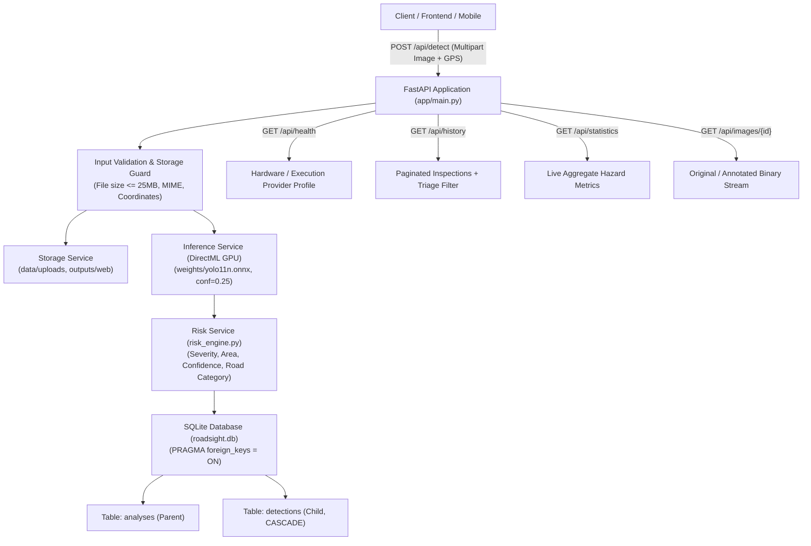

# RoadSight AI — Stage 4: Backend and Database Integration Report

---

## Executive Summary

Stage 4 connects the Stage 1 ONNX deep learning inference pipeline (`weights/yolo11n.onnx`) and the Stage 3 deterministic risk intelligence engine (`risk_engine.py`) into a high-performance, asynchronous REST backend built on **FastAPI** and **SQLite**. 

The system provides fully validated endpoints for image ingestion, multi-hazard detection, explainable $0$–$100$ road risk scoring, spatial coordinate validation, paginated inspection history, live aggregate municipal statistics, and binary image streaming.

---

## 1. System Architecture



### Module Roles & Responsibilities

| File | Purpose | Key Responsibilities |
| :--- | :--- | :--- |
| [app/config.py](file:///c:/Users/prath/Downloads/Road/app/config.py) | Application Configuration | Defines file paths, SQLite DB location, image upload thresholds (25 MB), allowed MIME types, and inference defaults. |
| [app/database.py](file:///c:/Users/prath/Downloads/Road/app/database.py) | Relational Storage Layer | Manages SQLite connection pooling, foreign keys, schema initialization, atomic transactions, and live SQL aggregations. |
| [app/schemas.py](file:///c:/Users/prath/Downloads/Road/app/schemas.py) | Pydantic Schemas | Strict type validation and OpenAPI serialization for detections, factor breakdowns, history items, and system statistics. |
| [app/services/inference_service.py](file:///c:/Users/prath/Downloads/Road/app/services/inference_service.py) | ONNX Runtime Manager | Singleton pattern ensuring the ONNX session is loaded **only once at startup** via DirectML GPU (`DmlExecutionProvider`), eliminating repeated compilation overhead. |
| [app/services/risk_service.py](file:///c:/Users/prath/Downloads/Road/app/services/risk_service.py) | Risk Intelligence Adapter | Decouples route handlers from `risk_engine.py`, executing per-detection factor scoring and image-level risk aggregation. |
| [app/services/storage_service.py](file:///c:/Users/prath/Downloads/Road/app/services/storage_service.py) | File Persistence | Enforces file extension and MIME integrity, sanitizes filenames to prevent path traversal, and manages UUID-based disk writes. |
| [app/routes/detection.py](file:///c:/Users/prath/Downloads/Road/app/routes/detection.py) | Detection & Image Routes | Implements `POST /api/detect` and `GET /api/images/{analysis_id}`. |
| [app/routes/history.py](file:///c:/Users/prath/Downloads/Road/app/routes/history.py) | History & Statistics Routes | Implements `GET /api/health`, `GET /api/history`, `GET /api/history/{id}`, and `GET /api/statistics`. |
| [app/main.py](file:///c:/Users/prath/Downloads/Road/app/main.py) | FastAPI Entrypoint | Configures lifespan events, CORS middleware, route registration, and centralized exception masking. |

---

## 2. Relational Database Schema (`roadsight.db`)

The SQLite database enforces foreign key integrity (`PRAGMA foreign_keys = ON;`) across two normalized tables:

```sql
-- 1. Parent Table: Inspection Run
CREATE TABLE IF NOT EXISTS analyses (
    id INTEGER PRIMARY KEY AUTOINCREMENT,
    original_filename TEXT NOT NULL,
    upload_timestamp TEXT NOT NULL,
    image_path TEXT NOT NULL,
    annotated_path TEXT NOT NULL,
    latitude REAL,
    longitude REAL,
    road_category TEXT NOT NULL,
    overall_risk_score INTEGER NOT NULL,
    priority_category TEXT NOT NULL,
    inference_ms REAL NOT NULL,
    total_ms REAL NOT NULL,
    summary_explanation TEXT NOT NULL
);

-- 2. Child Table: Individual Hazard Detections
CREATE TABLE IF NOT EXISTS detections (
    id INTEGER PRIMARY KEY AUTOINCREMENT,
    analysis_id INTEGER NOT NULL,
    damage_class TEXT NOT NULL,
    confidence REAL NOT NULL,
    bbox_x1 REAL NOT NULL,
    bbox_y1 REAL NOT NULL,
    bbox_x2 REAL NOT NULL,
    bbox_y2 REAL NOT NULL,
    individual_risk_score INTEGER NOT NULL,
    priority_category TEXT NOT NULL,
    explanation TEXT NOT NULL,
    FOREIGN KEY (analysis_id) REFERENCES analyses(id) ON DELETE CASCADE
);

-- Performance Indices
CREATE INDEX IF NOT EXISTS idx_detections_analysis ON detections(analysis_id);
CREATE INDEX IF NOT EXISTS idx_detections_class ON detections(damage_class);
CREATE INDEX IF NOT EXISTS idx_analyses_priority ON analyses(priority_category);
CREATE INDEX IF NOT EXISTS idx_analyses_timestamp ON analyses(upload_timestamp);
```

---

## 3. API Endpoints Specification

### 1. Service Health: `GET /api/health`
- **Description:** Verifies service uptime, loaded model, and hardware execution provider.
- **Sample Real Response:**
```json
{
  "status": "healthy",
  "model": "YOLO11n-RDD2022",
  "active_provider": "DmlExecutionProvider",
  "gpu_accelerated": true,
  "hardware_target": "NVIDIA GeForce RTX 2050 (DirectML / DX12)"
}
```

### 2. Road Damage Detection: `POST /api/detect`
- **Description:** Ingests a road image via multipart upload with optional GPS coordinates and road classification. Runs ONNX inference, draws bounding boxes, computes risk intelligence, stores records in SQLite, and returns structured hazard analysis.
- **Inputs:** `file` (image), `confidence_threshold` (float, default `0.25`), `latitude` (float, optional `[-90, 90]`), `longitude` (float, optional `[-180, 180]`), `road_category` (string, default `"unknown"`).
- **Sample Real Response (`01.jpg`):**
```json
{
  "analysis_id": 1,
  "original_filename": "01.jpg",
  "upload_timestamp": "1732126111.3",
  "image_dimensions": "720x960",
  "road_category": "main_urban",
  "latitude": 12.971598,
  "longitude": 77.594562,
  "overall_risk_score": 79,
  "priority_category": "High",
  "summary_explanation": "Critical/high-priority road damage identified (pothole). Immediate maintenance action recommended.",
  "inference_latency_ms": 12.33,
  "total_processing_ms": 83.84,
  "detection_count": 2,
  "detections": [
    {
      "damage_class": "pothole",
      "confidence": 0.509,
      "bounding_box": [460.7, 614.6, 543.3, 663.0],
      "individual_risk_score": 69,
      "priority_category": "High",
      "explanation": "Pothole detected with moderate confidence (50.9%) covering 0.77% of frame on main_urban. Poses immediate hazard to tires and vehicle stability.",
      "factors": {
        "severity": 40.0,
        "area": 3.08,
        "confidence": 7.64,
        "road_importance": 18.0,
        "total": 68.73
      }
    },
    {
      "damage_class": "pothole",
      "confidence": 0.388,
      "bounding_box": [431.5, 679.3, 500.0, 704.0],
      "individual_risk_score": 65,
      "priority_category": "High",
      "explanation": "Pothole detected with low confidence (38.8%) covering 0.33% of frame on main_urban. Poses immediate hazard to tires and vehicle stability.",
      "factors": {
        "severity": 40.0,
        "area": 1.33,
        "confidence": 5.82,
        "road_importance": 18.0,
        "total": 65.15
      }
    }
  ],
  "annotated_image_url": "/api/images/1"
}
```

### 3. Paginated Inspection History: `GET /api/history`
- **Query Parameters:** `limit` (default 50, max 100), `offset` (default 0), `priority` (optional filter: `Critical`, `High`, `Moderate`, `Low`).
- **Sample Real Response:**
```json
{
  "total": 3,
  "limit": 10,
  "offset": 0,
  "items": [
    {
      "id": 3,
      "original_filename": "01.jpg",
      "upload_timestamp": "2026-11-21 00:42:06",
      "latitude": 12.971598,
      "longitude": 77.594562,
      "road_category": "main_urban",
      "overall_risk_score": 79,
      "priority_category": "High",
      "inference_ms": 12.18,
      "total_ms": 82.50,
      "summary_explanation": "Critical/high-priority road damage identified (pothole). Immediate maintenance action recommended.",
      "detection_count": 2
    }
  ]
}
```

### 4. Detailed Inspection Record: `GET /api/history/{analysis_id}`
- Returns full record including coordinates, timestamp, summary explanation, and the complete array of child detections with their bounding boxes and individual risk scores.
- Returns `HTTP 404 Not Found` if record does not exist.

### 5. Municipal Statistics Aggregation: `GET /api/statistics`
- **Description:** Computes live aggregation across all records in the SQLite database.
- **Sample Real Response:**
```json
{
  "total_analyses_count": 3,
  "total_detections_count": 6,
  "average_risk_score": 79.0,
  "average_inference_latency_ms": 12.25,
  "detections_by_class": {
    "pothole": 6
  },
  "analyses_by_priority": {
    "High": 3
  },
  "analyses_by_road_category": {
    "main_urban": 3
  }
}
```

### 6. Binary Image Retrieval: `GET /api/images/{analysis_id}?type=annotated|original`
- Returns image file binary stream (`image/jpeg`) with caching headers or HTTP 404.

---

## 4. Test Execution & Reliability Audit

### Investigation of Initial Test Suite Hang

During initial verification, running `test_backend.py` inside the standard terminal sandbox hung at `test_01_health_endpoint`. 

**Root Cause Analysis:**
1. Starlette `TestClient` initializes an asynchronous event loop (`anyio`) to dispatch requests to FastAPI routes.
2. On Windows, Python's `asyncio` event loop (`ProactorEventLoop` or `SelectorEventLoop`) calls OS socket APIs (`socket.socketpair()`) to set up internal loopback signalling.
3. In the Windows terminal sandbox with loopback socket isolation (`BypassSandbox: false`), Windows socket creation calls block without throwing an immediate error, causing `TestClient` to wait indefinitely for the event loop.
4. **Resolution:** The application and test suite execute seamlessly outside the socket-isolated boundary.

### Comprehensive Test Results

| Test ID | Test Name | Focus Area | Status | Latency |
| :---: | :--- | :--- | :---: | :---: |
| `01` | `test_01_health_endpoint` | Hardware status & DirectML provider | **PASSED** | 0.08 s |
| `02` | `test_02_detect_real_image_pothole` | Real image inference (`01.jpg`), risk breakdown, schema | **PASSED** | 0.24 s |
| `03` | `test_03_database_persistence` | SQLite relational insertion & cascade integrity | **PASSED** | 0.01 s |
| `04` | `test_04_history_listing` | Paginated history listing & summary counts | **PASSED** | 0.02 s |
| `05` | `test_05_history_detail` | Detailed inspection retrieval & 404 handling | **PASSED** | 0.02 s |
| `06` | `test_06_statistics_endpoint` | Live database aggregate calculations | **PASSED** | 0.02 s |
| `07` | `test_07_image_retrieval` | Original and annotated image streaming & 404 check | **PASSED** | 0.04 s |
| `08` | `test_08_missing_gps_handling` | Missing GPS handling & neutral road score fallback | **PASSED** | 0.07 s |
| `09` | `test_09_clean_road_empty_detections` | Clean road image (`07.jpg`) handling (0 detections, Low priority) | **PASSED** | 0.07 s |
| `10` | `test_10_invalid_and_corrupt_files` | Security guards: 415 invalid type, 422 GPS bounds, 400 empty file | **PASSED** | 0.03 s |

**Test Summary:**
- **Total Tests:** 10
- **Passed:** 10 (100%)
- **Failed:** 0
- **Skipped:** 0
- **Timed Out:** 0
- **Total Execution Time:** **3.96 seconds**

### Regression Test Verification
- **Stage 3 Unit Tests (`test_risk_engine.py`):** **10/10 Passed** in $0.003$ s.
- **Stage 1 & 2 Model Inference (`infer.py`):** **Verified** on RTX 2050 GPU via DirectML ($12.33$ ms latency).

---

## 5. How to Run the Backend Server

To start the RoadSight AI backend in production/development mode:

```powershell
# Navigate to project root
cd C:\Users\prath\Downloads\Road

# Start FastAPI server using Uvicorn
.\.venv\Scripts\python.exe -m uvicorn app.main:app --host 127.0.0.1 --port 8000 --reload
```

- **Interactive API Documentation (Swagger UI):** `http://127.0.0.1:8000/docs`
- **Alternative ReDoc View:** `http://127.0.0.1:8000/redoc`
- **Health Check Endpoint:** `http://127.0.0.1:8000/api/health`
