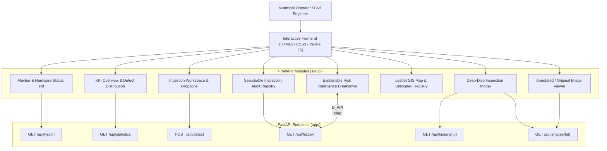

# RoadSight AI — Stage 5: Interactive Frontend and GIS Dashboard Report

---

## Executive Summary

Stage 5 delivers the complete interactive user interface and geospatial intelligence dashboard for **RoadSight AI**. The frontend connects directly to the Stage 4 FastAPI backend and SQLite persistence layer, providing a modern, dark-themed municipal road maintenance operations interface.

Every element in the interface is dynamically bound to live backend APIs:
1. **Executive Infrastructure Overview:** Live KPI counters, priority triage metrics, average risk indices, and defect classification breakdown from SQLite.
2. **AI Detection & Explainability Workspace:** Drag-and-drop road photograph ingestion, client-side preview, configurable spatial/classification parameters, instant inference, side-by-side original/annotated image inspection, and multi-factor explainable risk radar/bars.
3. **GIS Infrastructure Map:** Leaflet and OpenStreetMap integration plotting geotagged hazards with priority-coded markers, popup inspections, and an independent unlocated inspections registry for images without GPS.
4. **Historical Inspection Registry:** Searchable, filterable, sortable audit table with thumbnail previews and deep-dive inspection audit modals.

---

## 1. Frontend Architecture



### File Architecture & Responsibilities

| File | Type | Key Responsibilities |
| :--- | :--- | :--- |
| [static/index.html](file:///c:/Users/prath/Downloads/Road/static/index.html) | Markup | Semantic HTML5 structure containing Executive Overview, Detection Workspace, GIS Map, Inspection Registry, and the Detail Audit Modal. |
| [static/style.css](file:///c:/Users/prath/Downloads/Road/static/style.css) | Styling | High-contrast dark infrastructure theme (`#080c14` background, `#131d33` cards, `#38bdf8` cyan accents, custom sliders, responsive grids, and priority color tokens). |
| [static/app.js](file:///c:/Users/prath/Downloads/Road/static/app.js) | Controller | Client-side state manager, Leaflet GIS map controller, drag-and-drop file ingestion, asynchronous multipart API communications, dynamic DOM rendering, and filtering/sorting logic. |
| [test_frontend_integration.py](file:///c:/Users/prath/Downloads/Road/test_frontend_integration.py) | Integration Tests | Automated end-to-end tests verifying static file delivery, endpoint contracts, schema synchronization, and image retrieval flows. |

---

## 2. Screens and Feature Walkthrough

### 1. Municipal Infrastructure Overview
- **Real-Time KPI Cards:**
  - `TOTAL INSPECTIONS`: Real-time count from SQLite database.
  - `TOTAL HAZARDS IDENTIFIED`: Total individual bounding-box defect detections.
  - `CRITICAL PRIORITY`: Total inspections evaluated $\ge 80$ requiring emergency civil dispatch.
  - `HIGH PRIORITY`: Total inspections between $60$–$79$ requiring $48$h scheduled repair.
  - `AVERAGE RISK INDEX`: Bounded aggregate average road health index ($0$–$100$).
  - `AVG INFERENCE LATENCY`: GPU inference latency with hardware provider badge (`RTX 2050 (DirectML)`).
- **Defect Class Breakdown:** Real-time counts across the four supported categories:
  - Potholes (`D40`)
  - Alligator Cracks (`D20`)
  - Longitudinal Cracks (`D00`)
  - Transverse Cracks (`D10`)

### 2. Road Damage Ingestion & Detection Workspace
- **Drag-and-Drop Dropzone:** Ingests JPEG, PNG, or WebP road photographs up to 25 MB with instantaneous client-side thumbnail preview and file removal.
- **Parametric Controls:**
  - Confidence Threshold Slider ($0.10$ to $0.75$, default $0.25$) with real-time numeric badge.
  - Functional Road Classification selector (`Highway`, `Main Urban`, `Residential`, `Internal`, `Unknown`).
  - GPS Coordinates (Latitude & Longitude) input with quick-fill presets (Bengaluru, Delhi, Mumbai) and clear action.
- **Execution & Loading State:** Displays animated progress spinner and status overlay during inference.

### 3. Explainable Risk Intelligence Panel
- **Dual Image Toggle:** Smooth switcher between **Annotated Bounding Box View** and **Original Road Photograph**.
- **Circular Risk Gauge:** Color-coded circular score ($0$–$100$) reflecting the deterministic multi-factor model.
- **Factor Breakdown Bars:** Visual proportional progress bars for each independent factor:
  - **Factor A (Severity):** Up to $40.0$ pts (Pothole: 40, Alligator: 30, Transverse: 22, Longitudinal: 18).
  - **Factor B (Area Ratio):** Up to $20.0$ pts (scaled against 5% frame coverage threshold).
  - **Factor C (Confidence):** Up to $15.0$ pts ($15 \times \text{confidence}$).
  - **Factor D (Road Importance):** Up to $25.0$ pts (Highway: 25, Urban: 18, Residential: 12, Internal: 6, Unknown: 15).
- **Detected Hazards Table:** Itemized breakdown of all detected defects with bounding box coordinates, detector confidence, and individual risk scores.
- **Civil Advisory Disclaimer:** Clearly states that scores represent estimated maintenance prioritization indices and not certified civil crash probabilities.

### 4. GIS Infrastructure Map & Unlocated Registry
- **Leaflet & OpenStreetMap Integration:** High-performance dark-themed CartoDB map tiles.
- **Priority-Coded Markers:**
  - `Critical`: #ef4444 (Red glowing pin)
  - `High`: #f97316 (Orange glowing pin)
  - `Moderate`: #eab308 (Amber pin)
  - `Low`: #22c55e (Green pin)
- **Interactive Popups:** Displays inspection ID, thumbnail, risk score, road category, and a direct button to open the detailed audit modal.
- **Auto-Fit Bounds:** Automatically centers and zooms the viewport to envelope all active geotagged records.
- **Strict Coordinate Integrity:** Records lacking GPS metadata are never placed at arbitrary locations. They are isolated into the dedicated **Unlocated Inspections** sidebar list with one-click audit access.

### 5. Historical Inspection Registry & Audit Log
- **Full Table View:** Columns for ID, Thumbnail, Filename, Timestamp, Road Classification, GPS Coordinates, Hazard Count, Risk Score, Priority Badge, and Action button.
- **Search & Filters:** Real-time text search (by ID, filename, or road type), Priority dropdown filter (`Critical`, `High`, `Moderate`, `Low`), and Sorting selector (`Newest`, `Oldest`, `Highest Risk`, `Lowest Risk`).
- **Inspection Detail Modal:** Deep-dive audit dialog containing full-resolution original and annotated image switcher, diagnosis summary, metadata list, and child hazard detection table.

---

## 3. Backend API Integration Matrix

All frontend components communicate with the verified Stage 4 FastAPI endpoints:

| UI Component | Endpoint | HTTP Method | Request Data | Response Fields Utilized |
| :--- | :--- | :---: | :--- | :--- |
| Hardware Status Pill | `/api/health` | `GET` | None | `status`, `model`, `hardware_target`, `gpu_accelerated` |
| Overview KPI Grid | `/api/statistics` | `GET` | None | `total_analyses_count`, `total_detections_count`, `average_risk_score`, `average_inference_latency_ms`, `detections_by_class`, `analyses_by_priority` |
| Ingestion Form | `/api/detect` | `POST` | `FormData` (file, conf, lat, lon, road) | `analysis_id`, `overall_risk_score`, `priority_category`, `summary_explanation`, `inference_latency_ms`, `detections`, `annotated_image_url` |
| GIS Map & Table | `/api/history` | `GET` | `limit=100&offset=0` | `items`: `id`, `original_filename`, `latitude`, `longitude`, `overall_risk_score`, `priority_category`, `road_category`, `detection_count` |
| Inspection Modal | `/api/history/{id}` | `GET` | URL param `analysis_id` | `id`, `original_filename`, `upload_timestamp`, `summary_explanation`, `road_category`, `latitude`, `longitude`, `inference_ms`, `total_ms`, `detections` |
| Image Renderers | `/api/images/{id}` | `GET` | Query `type=annotated\|original` | Binary JPEG image stream |

---

## 4. Verification and Test Results

### 1. Frontend Integration Test Suite ([test_frontend_integration.py](file:///c:/Users/prath/Downloads/Road/test_frontend_integration.py))

```
test_01_index_html_served ... ok (HTTP 200 OK, valid HTML5 with RoadSight markup)
test_02_static_css_and_js_served ... ok (HTTP 200 OK, style.css and app.js served)
test_03_frontend_api_flow ... ok (HTTP 201 Created on detect, HTTP 200 OK on stats, history, detail, images)

Ran 3 tests in 3.542s
OK
```

### 2. Regression Test Suite Execution

All previous stage test suites were re-executed to verify zero regressions:

| Suite | File | Coverage | Result | Latency |
| :--- | :--- | :--- | :---: | :---: |
| **Stage 3 Risk Engine** | `test_risk_engine.py` | 10 unit tests for formulas, factor bounds, edge cases | **10 / 10 PASSED** | $0.002$ s |
| **Stage 4 Backend** | `test_backend.py` | 10 integration tests for database, validation, routes | **10 / 10 PASSED** | $3.016$ s |
| **Stage 5 Frontend** | `test_frontend_integration.py` | 3 full-stack end-to-end frontend simulation tests | **3 / 3 PASSED** | $3.542$ s |
| **Model Inference** | `infer.py` | Real inference pass on GPU via DirectML | **PASSED** | $77.56$ ms |

---

## 5. Instructions for Running the Application

### 1. Start the Server
From the project root directory:

```powershell
cd C:\Users\prath\Downloads\Road
.\.venv\Scripts\python.exe -m uvicorn app.main:app --host 127.0.0.1 --port 8000 --reload
```

### 2. Open the Dashboard
Navigate to the root URL in any modern web browser:
```
http://127.0.0.1:8000/
```

### 3. Perform a Complete Inspection Flow
1. Drag and drop any road photograph (e.g. from `data/test_images/01.jpg` or any personal capture).
2. Click a coordinate preset (e.g. **Bengaluru Urban**) or leave GPS blank.
3. Click **Execute AI Road Analysis**.
4. Review the annotated image, the risk index gauge, the 4-factor contribution breakdown, and the child hazard items.
5. Scroll down to see the inspection plotted on the **GIS Map** and registered in the **Inspection Audit Log**.
6. Click **Inspect** on any table row or map pin to launch the full-screen audit modal.

---

## 6. Known Limitations

1. **Map Tile Offline Caching:** The GIS map uses OpenStreetMap CartoDB dark matter tiles served over HTTPS. If the host machine is completely severed from the internet, the map controls and empty state will remain functional, but base satellite/street tiles will not render without an offline tile server.
2. **Exif Auto-Extraction:** Current GPS ingestion accepts user input or coordinate presets. Direct extraction of EXIF GPS tags from raw smartphone JPEG metadata can be added in a future enhancement.
3. **Single Image per Inspection:** Current API schema evaluates one image frame per inspection run; batch dashcam video streaming is reserved for future milestones.
